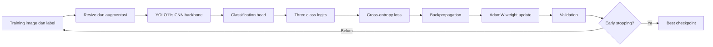
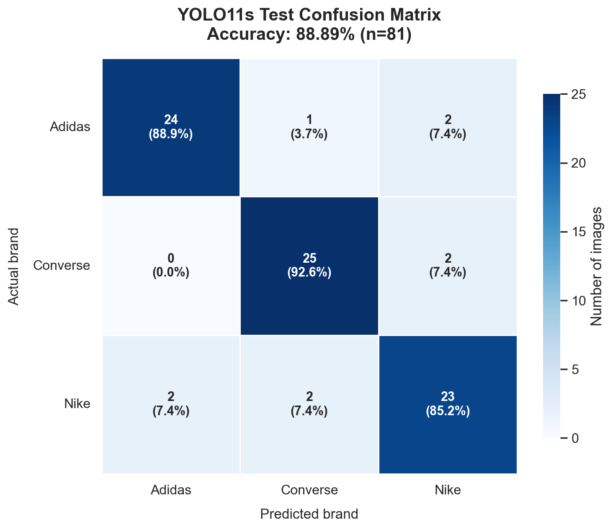

# Laporan Pengembangan Model Klasifikasi Merek Sepatu

**Model:** YOLO11s Classification  
**Kelas:** Adidas, Converse, Nike  
**Status:** Siap digunakan  
**Tanggal laporan:** 24 November 2026  
**Seed eksperimen:** 37

## Ringkasan

Proyek ini menghasilkan model klasifikasi citra untuk mengenali tiga merek sepatu: Adidas, Converse, dan Nike. Dataset publik `keremberke/shoe-classification` diproses menjadi 825 citra yang terbagi secara seimbang ke dalam data training, validation, dan test. Seluruh citra dinormalisasi menjadi JPEG RGB berukuran 224×224 piksel sebelum digunakan dalam pipeline modeling.

Model akhir menggunakan YOLO11s Classification dengan transfer learning bertahap dan resolusi inferensi 320×320 piksel. Evaluasi pada test set terisolasi menghasilkan accuracy **88,89%** dan macro-F1 **88,89%**. Model telah diekspor ke format PyTorch dan ONNX serta dilengkapi checksum SHA-256 untuk verifikasi integritas.

## Tujuan dan Ruang Lingkup

Tujuan proyek adalah membangun classifier citra yang menerima satu gambar sepatu dan menghasilkan satu dari tiga label berikut:

- `adidas`
- `converse`
- `nike`

Pipeline mencakup setup environment, akuisisi dataset, validasi kualitas data, stratified split, preprocessing, exploratory data analysis, transfer learning, evaluasi pada test set, dan packaging model untuk inference.

## Alur Pengembangan

```mermaid
flowchart LR
    A[Setup environment] --> B[Unduh dataset]
    B --> C[Audit dan stratified split]
    C --> D[Preprocessing 224x224 RGB]
    D --> E[EDA dan integrity checks]
    E --> F[YOLO11s transfer learning]
    F --> G[High-resolution refinement 320x320]
    G --> H[Validation]
    H --> I[Final test evaluation]
    I --> J[PyTorch dan ONNX package]
```



## 1. Setup Environment

Seluruh workflow modeling dijalankan melalui Jupyter Notebook dengan kernel Python global. Setup dan verifikasi dependency tersedia pada [`modeling/setup/setup_dependencies.ipynb`](modeling/setup/setup_dependencies.ipynb).

Environment training yang tercatat:

| Komponen | Versi atau konfigurasi |
|---|---:|
| Python | 3.11.9 |
| Ultralytics | 8.4.213 |
| PyTorch | 2.15.0+cpu |
| Device | CPU |
| Processor | Intel Core i5-10300H 2.50 GHz |
| ONNX | 1.23.2 |
| ONNX opset | 18 |

Dependency utama dipasang melalui notebook setup:

```text
datasets==3.6.0
ImageHash==4.3.2
inference-sdk==1.8.5
scikit-learn==1.8.0
seaborn==0.13.2
ultralytics==8.4.213
huggingface-hub<2.0
matplotlib
numpy
pandas
Pillow
PyYAML
```

Kernel harus menggunakan Python 3.10 sampai sebelum 3.14 agar kompatibel dengan `inference-sdk` yang digunakan repository.

## 2. Setup Dataset

Dataset dimuat dari Hugging Face melalui [`modeling/dataset/load_shoe_dataset.ipynb`](modeling/dataset/load_shoe_dataset.ipynb) dengan konfigurasi berikut:

| Atribut | Nilai |
|---|---|
| Dataset ID | `keremberke/shoe-classification` |
| Konfigurasi | `full` |
| Citra awal | 825 |
| Kelas | Adidas, Converse, Nike |
| Format ekspor | Folder klasifikasi per split dan kelas |
| Kualitas JPEG ekspor | 95 |

Dataset upstream memiliki 576 citra training, 166 citra validation, dan 83 citra test. Distribusi kelas pada split upstream tidak seimbang, terutama validation set yang seluruhnya berisi Nike. Seluruh 825 citra kemudian digabungkan per kelas dan dibagi ulang secara stratified.

Distribusi data setelah stratified split:

| Split | Adidas | Converse | Nike | Total |
|---|---:|---:|---:|---:|
| Training | 193 | 193 | 193 | 579 |
| Validation | 55 | 55 | 55 | 165 |
| Test | 27 | 27 | 27 | 81 |
| **Total** | **275** | **275** | **275** | **825** |

Setiap kelas memiliki proporsi 33,33% pada setiap split. Proses pembagian data menggunakan random seed 37 dan tersedia pada [`modeling/training/stratified_split.ipynb`](modeling/training/stratified_split.ipynb).

Sebelum split dibuat, setiap file diperiksa menggunakan SHA-256. Proses dihentikan jika jumlah citra per kelas tidak sesuai atau ditemukan exact duplicate. Setelah split selesai, checksum kembali diperiksa untuk memastikan tidak ada exact duplicate yang melintasi split.

## 3. Preprocessing

Preprocessing dilakukan secara non-destruktif melalui [`modeling/training/preprocessing.ipynb`](modeling/training/preprocessing.ipynb). Dataset sumber tetap dipertahankan dan hasil preprocessing ditulis ke `modeling/datasets/shoe_brands_preprocessed`.

Setiap citra melewati langkah berikut:

1. Membaca dan memvalidasi file citra.
2. Menerapkan EXIF auto-orientation dengan `ImageOps.exif_transpose`.
3. Mengonversi citra ke color mode RGB.
4. Mengubah ukuran menjadi 224×224 piksel menggunakan LANCZOS resampling.
5. Menyimpan hasil sebagai JPEG dengan quality 95 dan optimasi aktif.
6. Memeriksa ulang dimensi, color mode, jumlah file, checksum, brightness, dan contrast.

Hasil preprocessing:

| Pemeriksaan | Hasil |
|---|---:|
| Citra input | 825 |
| Citra output | 825 |
| Citra rusak | 0 |
| Resolusi output | 224×224 |
| Color mode | RGB |
| Exact duplicate | 0 grup |
| Exact duplicate lintas split | 0 grup |

Augmentasi tidak disimpan sebagai citra baru. Seluruh augmentasi diterapkan secara dinamis hanya pada training set selama proses training. Validation dan test set tidak menerima augmentasi training.

## 4. Exploratory Data Analysis

EDA dilakukan pada dataset hasil preprocessing melalui [`modeling/training/EDA.ipynb`](modeling/training/EDA.ipynb). Audit mencakup distribusi kelas, dimensi citra, ukuran file, color mode, brightness, contrast, file rusak, exact duplicate, dan potensi split leakage.

Ringkasan karakteristik dataset:

| Karakteristik | Minimum | Rata-rata | Median | Maksimum |
|---|---:|---:|---:|---:|
| Brightness | 34,56 | 181,45 | 196,49 | 249,71 |
| Contrast | 11,61 | 56,11 | 57,13 | 107,04 |
| Ukuran file (KB) | 4,20 | 15,75 | 15,19 | 35,94 |

Seluruh 825 citra dapat dibaca, berukuran 224×224, menggunakan color mode RGB, dan tidak memiliki exact duplicate. Tidak ditemukan kelas kosong maupun duplicate lintas split.

## 5. Arsitektur Model

Model menggunakan checkpoint pretrained `yolo11s-cls.pt` dari Ultralytics. Classification head disesuaikan untuk menghasilkan tiga probabilitas kelas.

| Atribut | Nilai |
|---|---:|
| Arsitektur | YOLO11s Classification |
| Input final | 320×320 RGB |
| Output | 3 probabilitas kelas |
| Parameter saat training | 5.446.851 |
| Layer saat training | 86 |
| Parameter setelah fusion | 5.437.971 |
| Layer setelah fusion | 47 |
| Inference strategy | Single forward pass |

Model menerima citra RGB, melakukan resize internal ke 320×320, lalu mengembalikan probabilitas untuk `adidas`, `converse`, dan `nike`. Label dengan probabilitas tertinggi digunakan sebagai hasil prediksi.

## 6. Training

Training final direkam pada [`modeling/training/train_yolo11s_robust.ipynb`](modeling/training/train_yolo11s_robust.ipynb). Seluruh tahap menggunakan batch size 16, optimizer AdamW, deterministic mode, seed 37, workers 0, dan early stopping.

### Algoritma dan Cara Kerja

Training menggunakan **supervised multiclass image classification** berbasis Convolutional Neural Network (CNN) pada arsitektur YOLO11s Classification. Setiap citra training memiliki satu label target, yaitu Adidas, Converse, atau Nike. Bobot awal berasal dari checkpoint pretrained `yolo11s-cls.pt`, kemudian disesuaikan terhadap dataset merek sepatu melalui transfer learning.

Alur optimasi untuk setiap batch adalah sebagai berikut:

1. **Preprocessing batch.** Citra training di-resize ke resolusi tahap aktif, dinormalisasi oleh pipeline Ultralytics, dan menerima augmentasi acak. Augmentasi hanya aktif pada training set.
2. **Feature extraction.** Backbone YOLO11s memproses citra melalui convolutional blocks untuk mempelajari pola visual bertingkat, mulai dari edge dan texture hingga bentuk, logo, serta karakteristik desain sepatu.
3. **Classification head.** Feature map diringkas dan diproyeksikan menjadi tiga logits, masing-masing untuk Adidas, Converse, dan Nike. Logit adalah skor mentah sebelum dikonversi menjadi probabilitas.
4. **Cross-entropy loss.** Implementasi `v8ClassificationLoss` pada Ultralytics 8.4.213 menghitung multiclass cross-entropy langsung dari logits dan label aktual. Untuk batch dengan ukuran \(N\), loss dinyatakan sebagai:

   $$
   \mathcal{L} = -\frac{1}{N}\sum_{i=1}^{N}
   \log\left(\operatorname{softmax}(\mathbf{z}_i)_{y_i}\right)
   $$

   dengan \(\mathbf{z}_i\) sebagai vektor logits dan \(y_i\) sebagai indeks kelas aktual. Prediksi yang memberi probabilitas rendah pada kelas aktual menghasilkan loss lebih besar.
5. **Backpropagation.** PyTorch menghitung gradien loss terhadap setiap parameter trainable menggunakan automatic differentiation. Gradien mengukur arah perubahan bobot yang akan menurunkan loss.
6. **AdamW update.** Optimizer AdamW memperbarui bobot menggunakan moving average dari gradien dan kuadrat gradien. Weight decay diterapkan secara terpisah dari pembaruan gradien untuk membantu regularisasi parameter.
7. **Validation.** Setelah setiap epoch, model dievaluasi pada validation set tanpa augmentasi training. Checkpoint dengan performa validation terbaik disimpan sebagai `best.pt`.
8. **Early stopping.** Training dihentikan apabila performa validation tidak membaik selama jumlah epoch yang ditentukan oleh parameter `patience`.

Saat inference, softmax mengubah tiga logits menjadi probabilitas yang berjumlah satu. Kelas dengan probabilitas tertinggi menjadi label prediksi dan probabilitas tersebut dilaporkan sebagai confidence.



Transfer learning dilaksanakan dalam tiga tahap. Tahap pertama melatih classification head dengan sebagian besar backbone dibekukan. Tahap kedua membuka seluruh jaringan untuk fine-tuning dengan learning rate lebih kecil. Tahap terakhir menaikkan resolusi menjadi 320×320 dan kembali menurunkan learning rate agar parameter menyesuaikan detail visual beresolusi lebih tinggi tanpa perubahan bobot yang agresif.

### Tahap 1 — Classification Head Adaptation

Tahap awal menggunakan bobot pretrained YOLO11s pada resolusi 224×224. Sepuluh layer pertama dibekukan agar classification head beradaptasi terhadap tiga kelas target.

| Parameter | Nilai |
|---|---:|
| Maksimum epoch | 20 |
| Epoch selesai | 16 |
| Early-stopping patience | 8 |
| Initial learning rate | 0,001 |
| Final LR factor | 0,05 |
| Weight decay | 0,0005 |
| Dropout | 0,15 |
| Resolusi | 224×224 |

### Tahap 2 — Progressive Fine-Tuning

Checkpoint terbaik tahap pertama digunakan untuk fine-tuning seluruh jaringan. Cosine learning-rate scheduling diaktifkan dan learning rate diturunkan.

| Parameter | Nilai |
|---|---:|
| Maksimum epoch | 40 |
| Epoch selesai | 38 |
| Early-stopping patience | 12 |
| Initial learning rate | 0,0001 |
| Final LR factor | 0,1 |
| Weight decay | 0,0007 |
| Dropout | 0,1 |
| Resolusi | 224×224 |

### Tahap 3 — High-Resolution Refinement

Checkpoint fine-tuned dilanjutkan pada resolusi 320×320 untuk menghasilkan model final.

| Parameter | Nilai |
|---|---:|
| Maksimum epoch | 30 |
| Epoch selesai | 14 |
| Early-stopping patience | 10 |
| Initial learning rate | 0,00005 |
| Final LR factor | 0,1 |
| Weight decay | 0,0007 |
| Dropout | 0,1 |
| Resolusi | 320×320 |
| Peak validation top-1 pada training log | 95,15% |
| Validation macro-F1 checkpoint final | 93,35% |

### Augmentasi Training

Augmentasi final diterapkan secara online dengan konfigurasi berikut:

| Augmentasi | Nilai |
|---|---:|
| Auto augment | RandAugment |
| Horizontal flip | 0,6 |
| Rotation | ±3° |
| Translation | 0,04 |
| Scale | 0,15 |
| HSV hue | 0,004 |
| HSV saturation | 0,15 |
| HSV value | 0,12 |
| Random erasing | 0,05 |

Vertical flip, mixup, cutmix, shear, dan perspective transform tidak digunakan. Konfigurasi ini mempertahankan orientasi alami sepatu sambil memberi variasi ringan pada posisi, skala, warna, dan occlusion.

## 7. Evaluasi

Checkpoint final dievaluasi pada validation set untuk memantau generalisasi selama pengembangan. Test set yang berisi 81 citra digunakan pada evaluasi akhir dan tidak digunakan untuk update bobot.

Metrik dihitung dengan Scikit-learn:

- accuracy;
- macro precision;
- macro recall;
- macro-F1;
- weighted-F1;
- precision, recall, dan F1 per kelas;
- confusion matrix.

Macro average digunakan untuk memberikan bobot yang sama kepada setiap kelas. Karena test set seimbang, weighted-F1 dan macro-F1 menghasilkan nilai yang sama.

## 8. Hasil Akhir

### Metrik Keseluruhan

| Metrik | Validation | Test |
|---|---:|---:|
| Accuracy | 93,33% | 88,89% |
| Macro precision | 93,38% | 88,93% |
| Macro recall | 93,33% | 88,89% |
| Macro-F1 | 93,35% | 88,89% |
| Weighted-F1 | 93,35% | 88,89% |

### Metrik Per Kelas pada Test Set

| Kelas | Precision | Recall | F1-score | Support |
|---|---:|---:|---:|---:|
| Adidas | 92,31% | 88,89% | 90,57% | 27 |
| Converse | 89,29% | 92,59% | 90,91% | 27 |
| Nike | 85,19% | 85,19% | 85,19% | 27 |

### Confusion Matrix

Gambar confusion matrix dibuat dari hasil evaluasi menggunakan [`modeling/training/generate_confusion_matrix.py`](modeling/training/generate_confusion_matrix.py). Baris menunjukkan label aktual, kolom menunjukkan hasil prediksi, dan persentase pada setiap sel dinormalisasi terhadap jumlah citra pada kelas aktual.



Gambar dapat diregenerasi dengan perintah berikut:

```powershell
python modeling/training/generate_confusion_matrix.py
```

Dari 81 citra test, 72 diklasifikasikan dengan benar dan 9 salah klasifikasi. Kesalahan terbesar terdapat pada kelas Nike, dengan dua citra diprediksi sebagai Adidas dan dua citra diprediksi sebagai Converse.

## 9. Packaging dan Artefak

Model final dipublikasikan pada direktori [`model/2026-11-17_11-30-28_yolo11s-robust-best`](model/2026-11-17_11-30-28_yolo11s-robust-best).

| Artefak | Format | Ukuran | SHA-256 |
|---|---|---:|---|
| `model.pt` | PyTorch | 10,52 MiB | `149807B8AF2AC2D1749B934BAC019B1FC067240FAD5D604DEFE461457C0073B4` |
| `model.onnx` | ONNX | 20,79 MiB | `A71080ACD5600BDDE8525468BDBB57BB8EFDDB7A5D54E3EB1066C06433799BB3` |
| `metadata.json` | JSON | 868 byte | Metadata konfigurasi dan evaluasi |

Artefak evaluasi lengkap tersedia pada `modeling/runs/training/yolo11s_robust`, meliputi:

- `classification_report.csv`;
- `confusion_matrix.csv`;
- `confusion_matrix.png`;
- `test_predictions.csv`;
- `metrics_summary.json`;
- `experiment_manifest.json`.

## 10. Inference

### PyTorch

```python
from ultralytics import YOLO

model = YOLO("model/2026-11-17_11-30-28_yolo11s-robust-best/model.pt")
results = model.predict("path/to/shoe.jpg", imgsz=320)

result = results[0]
predicted_index = int(result.probs.top1)
predicted_label = result.names[predicted_index]
confidence = float(result.probs.top1conf)

print({"label": predicted_label, "confidence": confidence})
```

### Ultralytics CLI dengan ONNX

```powershell
yolo predict task=classify `
  model=model/2026-11-17_11-30-28_yolo11s-robust-best/model.onnx `
  source=path/to/shoe.jpg `
  imgsz=320
```

Input inference sebaiknya menampilkan satu objek sepatu yang cukup jelas. Pipeline Ultralytics melakukan resize dan normalisasi input sesuai kebutuhan model.

## 11. Reproduksibilitas

Urutan notebook untuk mereproduksi pipeline:

1. [`modeling/setup/setup_dependencies.ipynb`](modeling/setup/setup_dependencies.ipynb)
2. [`modeling/dataset/load_shoe_dataset.ipynb`](modeling/dataset/load_shoe_dataset.ipynb)
3. [`modeling/training/stratified_split.ipynb`](modeling/training/stratified_split.ipynb)
4. [`modeling/training/preprocessing.ipynb`](modeling/training/preprocessing.ipynb)
5. [`modeling/training/EDA.ipynb`](modeling/training/EDA.ipynb)
6. [`modeling/training/train_yolo11s_robust.ipynb`](modeling/training/train_yolo11s_robust.ipynb)

Reproduksi menggunakan seed 37 dan deterministic mode. Hasil numerik tetap dapat berbeda kecil pada versi library, hardware, atau backend komputasi yang berbeda. Verifikasi checksum setelah packaging untuk memastikan artefak identik dengan model yang dilaporkan.

## 12. Batasan

- Evaluasi test menggunakan 81 citra, sehingga estimasi performa masih memiliki ketidakpastian pada kondisi dunia nyata.
- Model hanya mengenali tiga kelas yang terdapat pada dataset dan selalu menghasilkan salah satu dari tiga label tersebut.
- Dataset belum mencakup kelas `unknown`, produk non-sepatu, beberapa sepatu dalam satu gambar, atau merek di luar Adidas, Converse, dan Nike.
- Performa belum divalidasi pada data eksternal dengan kamera, pencahayaan, latar belakang, sudut, dan distribusi produk yang berbeda.
- Distribusi upstream harus dipastikan tetap sesuai dengan ketentuan lisensi dataset sebelum dataset atau turunannya dipublikasikan ulang.

## Kesimpulan

Pipeline menghasilkan model YOLO11s Classification tiga kelas dengan data yang seimbang, preprocessing konsisten, tidak ada exact duplicate lintas split, serta evaluasi akhir pada test set terisolasi. Model mencapai accuracy 88,89% dan macro-F1 88,89% pada test set. Artefak PyTorch dan ONNX telah disimpan bersama metadata dan checksum sehingga siap digunakan untuk integrasi inference dan evaluasi lanjutan.
